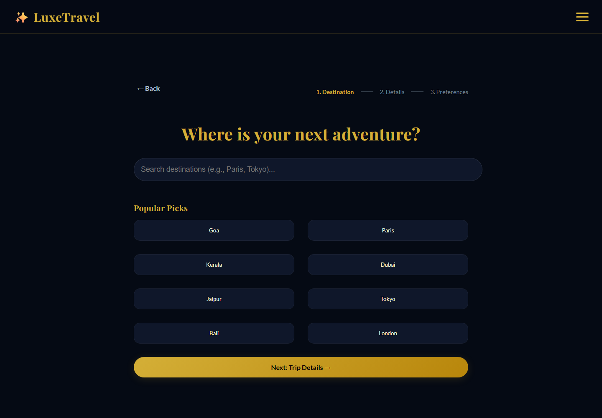
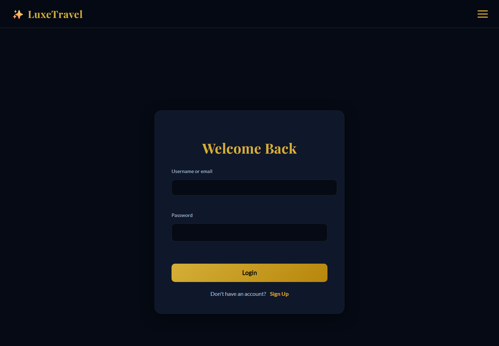
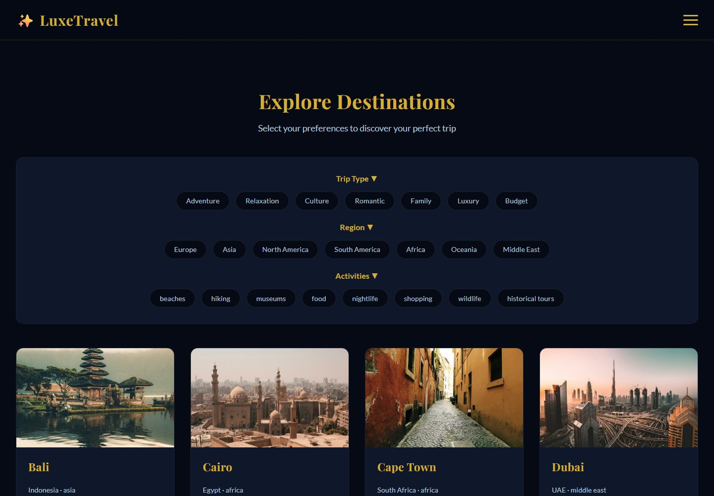
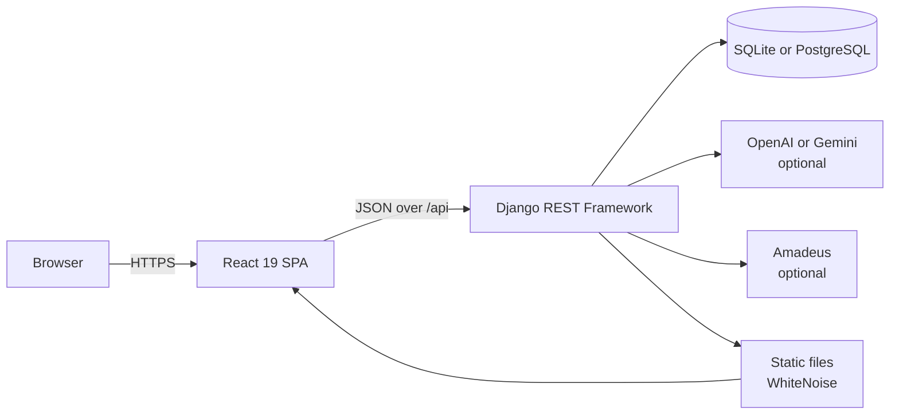

# LuxeTravel

**An AI-assisted trip planner that turns a destination, dates, and a budget into a complete, editable travel plan.**

LuxeTravel combines a React single-page application with a Django REST API. It generates day-by-day itineraries, recommends packing lists and local transport, visualises destinations, saves and shares trips, and lets travellers collaborate in trip-specific chatrooms.

<p>
  <a href="https://akanchha1804.github.io/LuxeTravel/"></a>
  
  
  
  
  
</p>

<p align="center">
  
</p>

> **Live preview:** <https://akanchha1804.github.io/LuxeTravel/>  
> GitHub Pages hosts the static React build only. The preview talks to a separately hosted Django API. If that API is offline, run the app locally using the instructions below.

---

## Table of contents

- [Overview](#overview)
- [Screenshots](#screenshots)
- [Features](#features)
- [Architecture](#architecture)
- [Tech stack](#tech-stack)
- [Getting started](#getting-started)
- [Configuration](#configuration)
- [API reference](#api-reference)
- [Data model](#data-model)
- [Testing](#testing)
- [Deployment](#deployment)
- [Project structure](#project-structure)
- [Security](#security)
- [Limitations and roadmap](#limitations-and-roadmap)
- [Documentation](#documentation)
- [Contributing](#contributing)
- [License](#license)
- [Acknowledgements](#acknowledgements)

---

## Overview

Planning a trip usually means jumping between tabs: one for inspiration, one for flights, one for hotels, one for a spreadsheet of activities. LuxeTravel brings those steps into a single flow.

A traveller selects a destination, dates, party size, budget, and interests. The application produces a structured itinerary with daily activities, a packing list, transport suggestions, and an interactive map. The plan can be regenerated, saved to an account, shared with a public link, forked by another traveller, or discussed in a private trip chatroom.

The project is designed to work **with or without external services**:

- With an AI key, itineraries are generated by OpenAI or Gemini.
- Without a key, the app falls back to a curated destination plan and keeps working.
- With Amadeus credentials, flight and hotel searches use live data.
- Without credentials, the booking page shows clearly labelled sample results.
- SQLite is the zero-configuration database; PostgreSQL is used automatically when `DATABASE_URL` is present.

This makes the project easy to demo locally while still supporting a production deployment.

---

## Screenshots

| Three-step planner | Account access |
| --- | --- |
|  |  |

<p align="center">
  
</p>

---

## Features

### Trip planning

- Three-step planner: destination, trip details, preferences.
- Date validation, traveller count, preset or custom budget.
- AI itinerary generation through OpenAI or Google Gemini.
- Curated fallback itineraries for popular destinations, with day-by-day activities.
- Packing lists, local transport links, and a live weather-forecast link.
- Interactive Leaflet map of itinerary stops.
- Regenerate, customise, save, and update an existing trip.

### Discovery

- Curated destination mood board with trip-type, region, and activity filters.
- Destination cards with descriptions and imagery.
- Flight and hotel search with live Amadeus data or labelled sample results.

### Sharing and collaboration

- Public share links with a short share code.
- Fork a shared trip into your own account.
- Public and private chatrooms with optional room codes.
- Trip-specific chatrooms created directly from the itinerary page.
- Message polling for near-real-time conversation.
- Fork counts and owner information on shared trips.

### Accounts and platform

- Token authentication with signup, login, logout, and session recovery.
- Owner-scoped trips: users only see and edit their own data.
- Admin-only access to user activity logs.
- Rate limiting for anonymous, authenticated, and AI requests.
- Health endpoint reporting database and integration status.
- Responses styled for mobile and desktop.

---

## Architecture



LuxeTravel supports three deployment shapes:

| Mode | Frontend | Backend | Typical use |
| --- | --- | --- | --- |
| **Single service** | Served by Django/WhiteNoise | Django | Production, Docker, Render |
| **Split development** | Create React App on `:3000` | Django on `:8000` | Local development with hot reload |
| **Static frontend** | GitHub Pages | Django hosted elsewhere | Public frontend preview |

The single-service mode is the primary production target because it keeps the frontend and API on one origin, avoids CORS, and requires one deployable unit.

---

## Tech stack

| Layer | Technology |
| --- | --- |
| Frontend | React 19, React Router 6, Create React App |
| Styling | Custom CSS, Font Awesome |
| Maps | Leaflet, OpenStreetMap tiles |
| Backend | Django 6, Django REST Framework |
| Authentication | DRF token authentication, Django sessions for admin |
| Database | SQLite by default, PostgreSQL via `DATABASE_URL` |
| AI (optional) | OpenAI Python SDK, Google Gen AI SDK |
| Travel data (optional) | Amadeus Self-Service APIs |
| Static serving | WhiteNoise |
| Production server | Gunicorn (Linux) or Waitress (Windows) |
| Deployment | Docker, Render blueprint, GitHub Pages |

---

## Getting started

### Prerequisites

- **Python 3.12+**
- **Node.js 18+** and npm
- **Git**
- Optional: PostgreSQL 14+
- Optional: OpenAI, Gemini, or Amadeus credentials

### 1. Clone the repository

```bash
git clone https://github.com/Akanchha1804/LuxeTravel.git
cd LuxeTravel
```

### 2. Configure the backend

```bash
cd backend
cp .env.example .env
```

Open `backend/.env` and set at least:

```dotenv
DEBUG=True
SECRET_KEY=replace-with-a-long-random-string
ALLOWED_HOSTS=localhost,127.0.0.1
```

Generate a suitable key with:

```bash
python -c "import secrets; print(secrets.token_urlsafe(50))"
```

The `.env` file is git-ignored. Never commit real credentials.

### 3. Run the full app as one service (recommended)

**Windows (PowerShell), from the repository root:**

```powershell
.\start-live.ps1 -Build
```

**macOS / Linux:**

```bash
python3 -m venv .venv
source .venv/bin/activate
pip install -r backend/requirements.txt
npm ci
npm run build

cd backend
export DEBUG=False
export SECRET_KEY="$(python -c 'import secrets; print(secrets.token_urlsafe(50))')"
python manage.py migrate
python manage.py collectstatic --noinput
python -m waitress --listen=0.0.0.0:8000 --threads=8 trip_planner.wsgi:application
```

Open <http://localhost:8000>. The React build is served by WhiteNoise and the API lives under `/api/`.

> `DEBUG=False` requires `SECRET_KEY`. The Windows script reads it from `backend/.env`; on macOS/Linux export it in the shell.

### 4. Run in development mode

Start the backend:

```bash
cd backend
python manage.py migrate
python manage.py runserver
```

In a second terminal, from the repository root:

```bash
npm install
npm start
```

Open <http://localhost:3000>. Create React App proxies `/api` to `http://localhost:8000`, so no CORS setup is needed.

### 5. Create an admin user (optional)

```bash
cd backend
python manage.py createsuperuser
```

Then visit <http://localhost:8000/admin/>.

---

## Configuration

All backend settings are environment-driven. See `backend/.env.example` for the full list.

### Core

| Variable | Default | Description |
| --- | --- | --- |
| `DEBUG` | `False` | Enables debug mode; use `True` only in development. |
| `SECRET_KEY` | none | Required when `DEBUG=False`. |
| `ALLOWED_HOSTS` | `localhost,127.0.0.1,0.0.0.0` | Comma-separated hostnames. |
| `CSRF_TRUSTED_ORIGINS` | empty | HTTPS origins for Django admin/CSRF. |
| `APP_VERSION` | `1.0.0` | Reported by the health endpoint. |

### Database

| Variable | Default | Description |
| --- | --- | --- |
| `DATABASE_URL` | empty | PostgreSQL connection URL; takes priority over `DB_*`. |
| `DB_ENGINE` | `sqlite` | Set to `postgres` for a local PostgreSQL instance. |
| `DB_NAME`, `DB_USER`, `DB_PASSWORD`, `DB_HOST`, `DB_PORT` | see example | PostgreSQL connection details. |
| `SQLITE_PATH` | `backend/db.sqlite3` | Custom SQLite file path. |

### Frontend

| Variable | Default | Description |
| --- | --- | --- |
| `REACT_APP_API_URL` | `/api` | API base URL. Leave empty for single-service deployments. |
| `PUBLIC_URL` | empty | Build-time base path for static hosting. |

Only `REACT_APP_*` values are exposed to the browser. **Never put server secrets in frontend variables.**

### Optional integrations

| Variable | Effect when unset |
| --- | --- |
| `OPENAI_API_KEY`, `OPENAI_MODEL` | Gemini is tried next; otherwise curated plans are used. |
| `GEMINI_API_KEY`, `GEMINI_MODEL` | Same fallback chain. |
| `AMADEUS_CLIENT_ID`, `AMADEUS_CLIENT_SECRET`, `AMADEUS_ENV` | Booking search returns labelled sample flights and hotels. |

### Rate limits

| Variable | Default |
| --- | --- |
| `THROTTLE_ANON` | `120/min` |
| `THROTTLE_USER` | `600/min` |
| `THROTTLE_AI` | `10/min` |

### HTTPS and security

| Variable | Default | Description |
| --- | --- | --- |
| `SECURE_SSL_REDIRECT` | `False` | Redirect HTTP to HTTPS. |
| `SESSION_COOKIE_SECURE` | `not DEBUG` | Mark session cookies secure. |
| `CSRF_COOKIE_SECURE` | `not DEBUG` | Mark CSRF cookies secure. |
| `SECURE_HSTS_SECONDS` | `0` | Enable HSTS after confirming HTTPS works. |
| `CORS_ALLOWED_ORIGINS` | empty | Required when the frontend is on another origin. |
| `CORS_ALLOW_ALL_ORIGINS` | `False` | Defaults to `True` only in debug mode with no explicit origins. |

---

## API reference

Authentication uses DRF tokens:

```http
Authorization: Token <token>
```

### Authentication

| Method | Endpoint | Description |
| --- | --- | --- |
| `POST` | `/api/signup/` | Create an account and return a token. |
| `POST` | `/api/login/` | Log in with username or email. |
| `POST` | `/api/logout/` | Invalidate the current token. |
| `GET` | `/api/me/` | Return the authenticated user. |

### Trips

| Method | Endpoint | Description |
| --- | --- | --- |
| `GET`, `POST` | `/api/trips/` | List or create the current user's trips. |
| `GET`, `PATCH`, `DELETE` | `/api/trips/{id}/` | Retrieve, update, or delete an owned trip. |
| `GET` | `/api/trips/my_trips/` | Explicit owner-scoped trip list. |
| `POST` | `/api/trips/preview/` | Generate an itinerary without saving it. |
| `POST` | `/api/trips/{id}/generate_itinerary/` | Regenerate the itinerary for a saved trip. |
| `POST` | `/api/trips/{id}/make-public/` | Create or return a public share link. |
| `POST` | `/api/trips/{id}/create-chatroom/` | Create or return the trip's chatroom. |
| `GET`, `POST` | `/api/bookings/` | List or create bookings for the current user's trips. |

### Sharing

| Method | Endpoint | Description |
| --- | --- | --- |
| `GET` | `/api/shared/{share_code}/` | Public view of a shared trip. |
| `POST` | `/api/shared/{share_code}/fork/` | Copy a shared trip into the current account. |

### Chat

| Method | Endpoint | Description |
| --- | --- | --- |
| `GET`, `POST` | `/api/chatrooms/` | List or create public rooms. |
| `POST` | `/api/chatrooms/join_private/` | Join a private room by code. |
| `GET`, `POST` | `/api/chatrooms/{id}/messages/` | Read or send messages. |

Private rooms require the room code in the `X-Room-Code` header, a `code` query parameter, or room ownership.

### Travel and content

| Method | Endpoint | Description |
| --- | --- | --- |
| `GET` | `/api/travel/flights/` | Server-side Amadeus proxy; sample data when unconfigured. |
| `GET` | `/api/travel/hotels/` | Server-side Amadeus proxy; sample data when unconfigured. |
| `GET` | `/api/destinations/` | Read-only destination catalogue with filters. |
| `GET` | `/api/user-activities/` | Admin-only activity log. |
| `GET` | `/api/health/` | Public service and integration health. |

### Example

```bash
# Create an account
curl -X POST http://localhost:8000/api/signup/ \
  -H "Content-Type: application/json" \
  -d '{"username":"traveller","email":"traveller@example.com","password":"a-strong-password"}'

# List your trips with the returned token
curl http://localhost:8000/api/trips/ \
  -H "Authorization: Token <token>"
```

---

## Data model

| Model | Purpose |
| --- | --- |
| `Trip` | Destination, dates, budget, preferences, itinerary JSON, sharing, chatroom, fork metadata. |
| `ChatRoom` | Public or private room with an optional access code and owner. |
| `Message` | Room messages with sender and timestamp. |
| `Booking` | Provider reference and status for planned bookings. |
| `Destination` | Mood-board catalogue with region, trip types, activities, and imagery. |
| `UserActivity` | Optional search/preference log used for personalisation context. |

Migrations live in `backend/trips/migrations/`. The latest migration adds trip ordering, `updated_at`, chatroom ownership, and indexes.

---

## Testing

Run the backend suite from `backend/`:

```bash
python manage.py test
```

The 11 API tests cover:

- Signup, login, and password validation
- Trip ownership and privacy
- Budget and date validation
- Sharing and forking
- Private chatroom access
- Health reporting
- Admin-only activity reads

There is no frontend test suite yet. The Create React App/Jest runner is available if you add one:

```bash
npm test -- --watchAll=false
```

---

## Deployment

### Option A: single service on Render (recommended)

The repository includes `render.yaml`, `build.sh`, and a production-ready `Dockerfile`.

1. Sign in to [Render](https://render.com).
2. Choose **New → Blueprint** and connect this repository.
3. Render provisions the web service and PostgreSQL database from `render.yaml`.
4. Add optional AI/Amadeus keys in the dashboard.
5. Deploy. The health check is `/api/health/`.

`render.yaml` sets `DEBUG=False`, generates `SECRET_KEY`, configures HTTPS redirects, and connects `DATABASE_URL` automatically.

### Option B: Docker

```bash
docker build -t luxetravel .
docker run -p 8000:8000 \
  -e SECRET_KEY="$(python -c 'import secrets; print(secrets.token_urlsafe(50))')" \
  -e ALLOWED_HOSTS=localhost,127.0.0.1 \
  luxetravel
```

The image builds the React app, collects static files, applies migrations on startup, and serves the app with Gunicorn.

### Option C: static frontend on GitHub Pages

The current live preview uses a `gh-pages` branch:

1. Build the frontend against a reachable backend:

   **PowerShell**

   ```powershell
   $env:PUBLIC_URL = "https://<user>.github.io/<repo>"
   $env:REACT_APP_API_URL = "https://your-api.example.com/api"
   npm run build
   Copy-Item build\index.html build\404.html
   New-Item build\.nojekyll -ItemType File -Force
   ```

   **Bash**

   ```bash
   PUBLIC_URL="https://<user>.github.io/<repo>" \
   REACT_APP_API_URL="https://your-api.example.com/api" \
   npm run build
   cp build/index.html build/404.html
   touch build/.nojekyll
   ```

2. Publish `build/` to the `gh-pages` branch using your preferred method, for example:

   ```bash
   npx gh-pages -d build --branch gh-pages
   ```

3. In **Settings → Pages**, set the source to the `gh-pages` branch and `/` directory.

The `404.html` copy lets React Router handle deep links, and `.nojekyll` prevents Jekyll processing. The backend must allow the Pages origin through `CORS_ALLOWED_ORIGINS`.

> **Important:** GitHub Pages cannot run Django. The frontend and backend are separate deployments in this mode. If the API URL changes, rebuild and republish the frontend.

### Production checklist

- [ ] Set `DEBUG=False` and a strong `SECRET_KEY`.
- [ ] Configure `ALLOWED_HOSTS` and `CSRF_TRUSTED_ORIGINS`.
- [ ] Use PostgreSQL via `DATABASE_URL` for concurrent traffic.
- [ ] Enable HTTPS, secure cookies, and HSTS.
- [ ] Restrict `CORS_ALLOWED_ORIGINS` to known frontend origins.
- [ ] Run `python manage.py migrate` and `collectstatic`.
- [ ] Set up database backups and log aggregation.
- [ ] Keep AI and Amadeus credentials server-side only.

---

## Project structure

```text
.
├── src/
│   ├── components/          Navbar, map widget
│   ├── pages/               Home, Planner, Results, MoodBoard, SavedTrips,
│   │                        SharedTrip, Booking, Chatroom, Login, Signup
│   └── services/            Central API client and travel helpers
├── public/                  Create React App HTML shell
├── backend/
│   ├── trip_planner/        Django settings, URLs, WSGI/ASGI
│   ├── trips/
│   │   ├── models.py        Trips, chat, bookings, destinations, activity
│   │   ├── views.py         REST endpoints and authorization
│   │   ├── serializers.py   Validation and response shaping
│   │   ├── ai.py            OpenAI/Gemini provider abstraction
│   │   ├── amadeus.py       Server-side travel API client
│   │   ├── tests.py         API test suite
│   │   └── migrations/
│   ├── requirements.txt
│   └── .env.example
├── docs/                    Development history and screenshots
├── Dockerfile
├── render.yaml
├── build.sh
├── Procfile
├── start-live.ps1
└── package.json
```

---

## Security

- API keys and travel credentials are read server-side only.
- Trip queries are scoped to the authenticated owner; staff users can access all trips.
- Private chatrooms require a matching room code or ownership.
- Booking creation verifies that the referenced trip belongs to the caller.
- `UserActivity` reads are restricted to staff users.
- Anonymous, authenticated, and AI endpoints have separate rate limits.
- Token auth is used for the SPA; invalid tokens are cleared automatically on `401`.
- Production settings disable debug renderers, set security headers, and support HTTPS redirects/HSTS.
- CORS is denied by default in production unless explicitly configured.

If you discover a security issue, please contact the repository owner privately rather than opening a public issue with exploit details.

---

## Limitations and roadmap

| Area | Current state | Planned improvement |
| --- | --- | --- |
| Booking | Creates a demo booking reference | Integrate a real ticketing/booking provider |
| Weather | Links to a live forecast | Embed a weather API with per-day forecasts |
| AI | Optional; curated fallback when unconfigured | Streaming generation and richer personalisation |
| Travel search | Optional Amadeus integration | Add result caching and price alerts |
| Accounts | Token auth, signup/login/logout | Email verification, password reset, refresh tokens |
| Chat | Polling every few seconds | WebSockets and presence indicators |
| Frontend tests | No test suite yet | Component and end-to-end coverage |
| Static preview | GitHub Pages depends on a separately hosted API | Single-service managed deployment |

---

## Documentation

`docs/` contains historical development notes, setup guides, and troubleshooting logs from earlier phases. They are useful for context but may describe older behaviour. This README and the code are the source of truth for the current architecture.

---

## Contributing

1. Fork the repository and create a feature branch:
   ```bash
   git checkout -b feature/your-feature
   ```
2. Make the change and keep it focused.
3. Run the backend tests:
   ```bash
   cd backend && python manage.py test
   ```
4. Build the frontend to catch compile errors:
   ```bash
   npm run build
   ```
5. Commit with a clear message and open a pull request.

Please do not commit `.env` files, database dumps, API keys, or generated build output.

---

## License

This repository does not currently include a license file. Until one is added, the code remains under the author's copyright and is not licensed for redistribution. Contact the repository owner before reusing it in another project.

---

## Acknowledgements

- [Django](https://www.djangoproject.com/) and [Django REST Framework](https://www.django-rest-framework.org/)
- [React](https://react.dev/) and [Create React App](https://create-react-app.dev/)
- [Leaflet](https://leafletjs.com/) and [OpenStreetMap](https://www.openstreetmap.org/)
- [OpenAI](https://openai.com/) and [Google Gemini](https://ai.google.dev/)
- [Amadeus for Developers](https://developers.amadeus.com/)
- [Font Awesome](https://fontawesome.com/)
- [Unsplash](https://unsplash.com/) and [Picsum](https://picsum.photos/) for demo imagery
